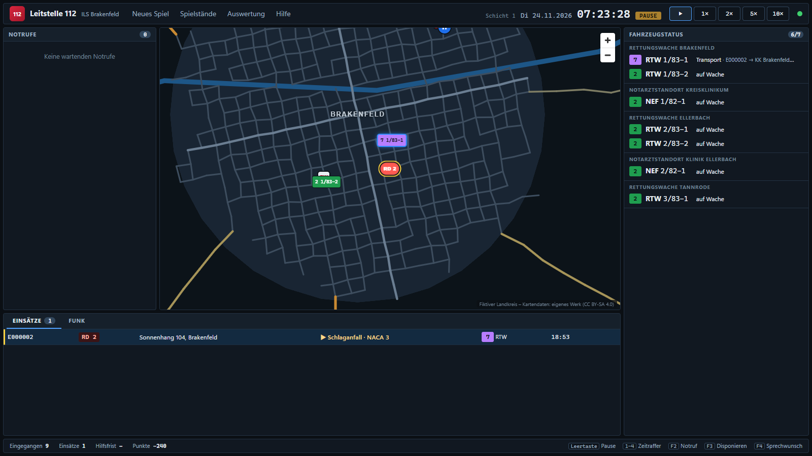
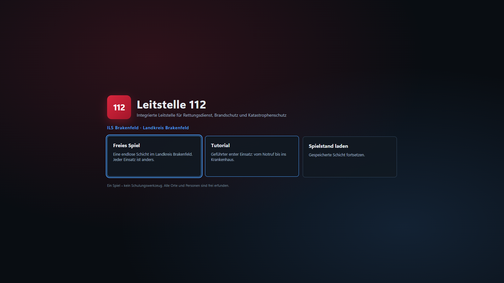
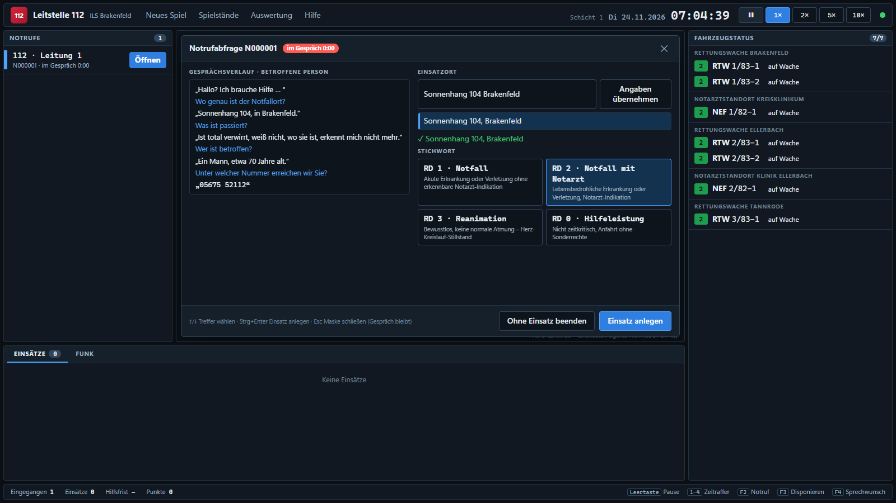
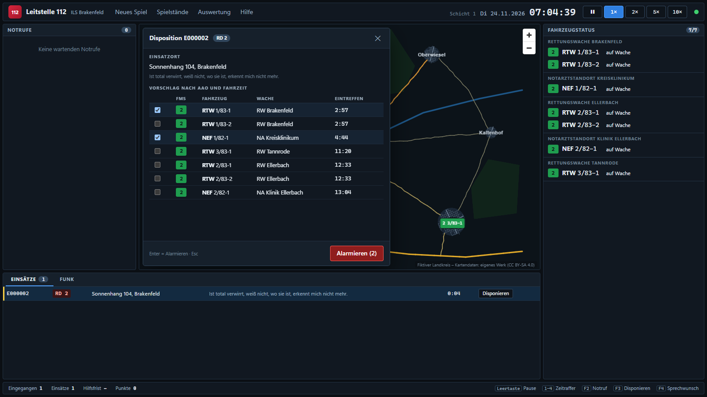
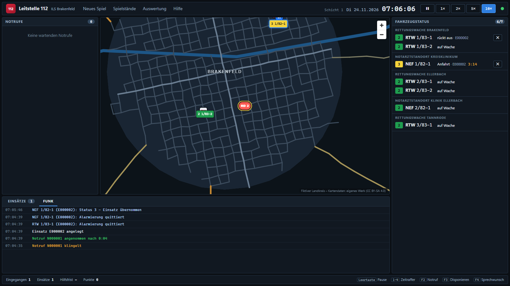
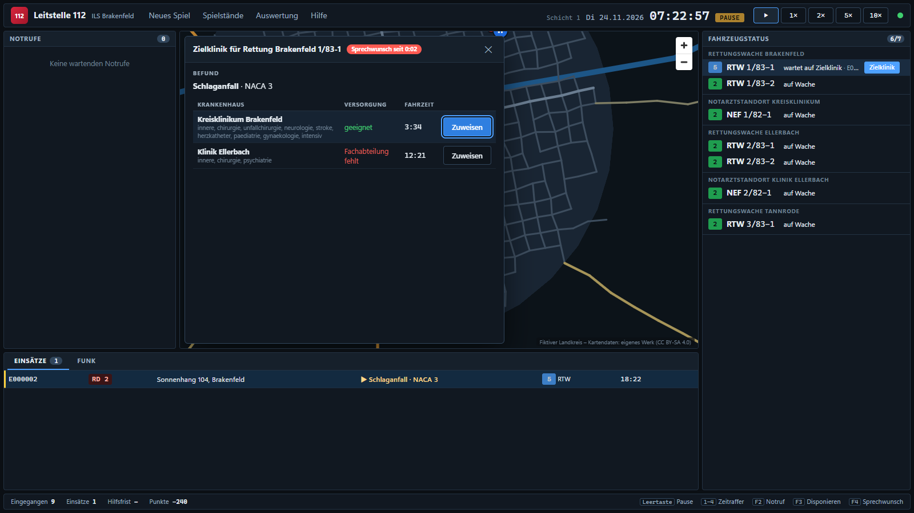
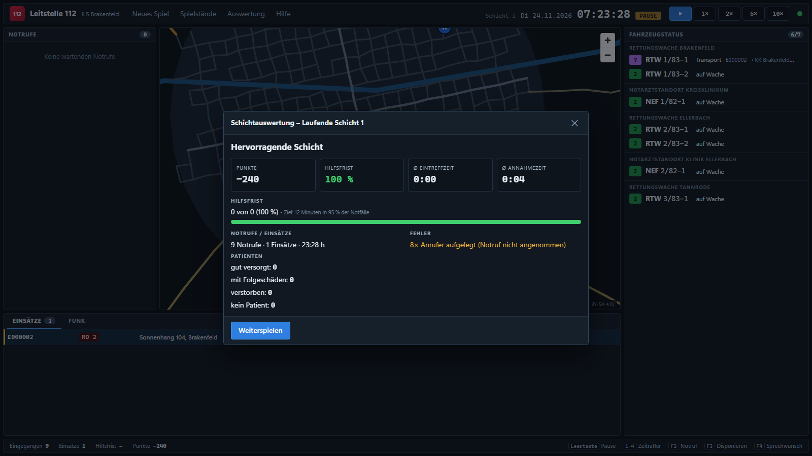

<div align="center">

# 🚑 Leitstelle 112

**Realistischer Leitstellensimulator für Rettungsdienst, Feuerwehr und Katastrophenschutz –
offline, für Windows.**

[](https://github.com/samuelklsn/leitstelle-112/actions/workflows/ci.yml)
[](https://github.com/samuelklsn/leitstelle-112/releases)
[](LICENSE)
[](content/LICENSE.md)


[Herunterladen](https://github.com/samuelklsn/leitstelle-112/releases) ·
[Roadmap](https://github.com/samuelklsn/leitstelle-112/milestones) · [Plan](docs/PLAN.md) ·
[Architektur](docs/adr/README.md) · [Fachliche Grundlagen](docs/domain/README.md) ·
[Mitmachen](CONTRIBUTING.md)



</div>

## Worum geht es?

Du sitzt als Disponentin oder Disponent in der Integrierten Leitstelle Brakenfeld. Das Telefon
klingelt. Eine Angehörige meldet, ihr Mann sei „total verwirrt“. Du fragst ab, findest die Adresse,
wählst das Stichwort und alarmierst den nächsten RTW nach **echter Fahrzeit**. Vor Ort meldet die
Besatzung: **Verdacht auf Schlaganfall**. Jetzt zählt die richtige Zielklinik mit Stroke Unit, und
auf Leitung 2 klingelt schon der nächste Notruf.

## Was dieses Spiel ausmacht

- **Die gemeldete Lage ist nicht die wahre Lage.** Anrufer übertreiben, verharmlosen, nennen die
  falsche Hausnummer oder vergessen den Ort. Erst die Rückmeldung vor Ort zeigt, was wirklich los ist:
  Notarzt nachfordern, Kräfte abbestellen, Rückruf bei falscher Adresse.
- **Echte Fahrzeiten:** lokales Routing auf dem Straßennetz, abhängig von Straßentyp, Tageszeit,
  Berufsverkehr und Sonderrechten. Ein Fluss mit wenigen Brücken sorgt für echte Umwege.
- **Realistische Abläufe:** FMS-Status 1–8, Sprechwünsche, Alarm- und Ausrückeordnung,
  Ausrückzeiten bei Tag und Nacht, Übergabe im Krankenhaus, Rückfahrt zur Wache.
- **Nie durchgespielt:** Einsätze entstehen aus Bausteinen (Krankheitsbild × Patient × Ort ×
  Anrufer × Tageszeit). Rund 15.000 Adressen, 14 Krankheitsbilder und unzählige Kombinationen sorgen
  dafür, dass jede Schicht anders verläuft ([ADR-0014](docs/adr/0014-endlosspiel-prozedurale-vielfalt.md)).
- **Ehrliche Auswertung:** Hilfsfrist-Quote, Eintreff- und Annahmezeiten, Patientenoutcome,
  Dispositionsfehler und Auslastung jedes Fahrzeugs.
- **Komplett offline:** keine Accounts, keine Telemetrie. Spielstände bleiben lokal.
- **Modbar:** Region, Wachen, Fahrzeuge, Stichworte und Krankheitsbilder sind YAML-Dateien mit
  Schema-Prüfung.

## Screenshots

|                                                                   |                                                               |
| ----------------------------------------------------------------- | ------------------------------------------------------------- |
|                |                |
| **Startbildschirm:** freies Spiel, Tutorial oder Spielstand laden | **Notrufabfrage:** Gesprächsverlauf, Adresssuche, Stichwort   |
|                        |          |
| **Disposition:** Vorschlag nach AAO und echter Fahrzeit           | **Lagekarte und Funk:** Anfahrt mit Sonderrechten, FMS-Status |
|                          |                      |
| **Sprechwunsch:** Zielklinik nach Befund und Fachabteilung        | **Schichtauswertung:** Hilfsfrist, Fehler, Outcome            |

## Spielen

1. Installer von der [Release-Seite](https://github.com/samuelklsn/leitstelle-112/releases)
   herunterladen (`Leitstelle112-Setup-x.y.z.exe`).
2. Installieren, ohne Administratorrechte.
3. Zum Einstieg **Tutorial** wählen: Es führt durch den ersten Einsatz vom Notruf bis ins Krankenhaus.

> Der Installer ist noch nicht signiert. Windows SmartScreen zeigt deshalb eine Warnung
> („Weitere Informationen“ → „Trotzdem ausführen“).

### Tastatur

| Taste                  | Funktion                                       |
| ---------------------- | ---------------------------------------------- |
| `F2`                   | Ältesten Notruf annehmen                       |
| `F3`                   | Einsatz ohne (ausreichende) Kräfte disponieren |
| `F4`                   | Ältesten Sprechwunsch bearbeiten (Zielklinik)  |
| `Enter` / `Strg+Enter` | Vorschlag bestätigen / Einsatz anlegen         |
| `Leertaste`            | Pause                                          |
| `1`–`4`                | Zeitraffer 1×, 2×, 5×, 10×                     |
| `Esc`                  | Dialog schließen                               |

## Stand und Roadmap

**v0.1.0 – Vertical Slice:** Rettungsdienst im fiktiven Landkreis Brakenfeld. Dazu gehören
7 Orte, 3 Rettungswachen, 2 Notarztstandorte, 2 Krankenhäuser, 4 Stichworte und
14 Krankheitsbilder, außerdem Tutorial, Speichern und Laden sowie die Schichtauswertung.

| Meilenstein       | Inhalt                                                                                   | Stand                                                              |
| ----------------- | ---------------------------------------------------------------------------------------- | ------------------------------------------------------------------ |
| M1 Fundament      | Monorepo, CI, Electron, deterministischer Simulationskern                                | ✅                                                                 |
| M2 Welt & Routing | Landkreis-Generator, Straßengraph, Fahrzeitmodell, Offline-Karte                         | ✅                                                                 |
| M3 Vertical Slice | Notruf → Disposition → Anfahrt → Befund → Transport → Krankenhaus                        | ✅                                                                 |
| M4 v0.1.0         | Speichern, Autosave, Auswertung, Tutorial, Tastatur                                      | ✅                                                                 |
| M5 – M12          | Dialoggenerator, Feuerwehr, Logistik, Wetter, Mehrmonitor, MANV, Langzeitspiel, Editoren | [geplant](https://github.com/samuelklsn/leitstelle-112/milestones) |

## Technik

Electron · TypeScript (strict) · React · MapLibre GL · SQLite (`node:sqlite`) · Zod · Vitest ·
fast-check · Playwright

Der Simulationskern ist deterministisch: Gleicher Seed und gleiche Eingaben ergeben immer denselben
Verlauf. So lassen sich Abstürze per Replay nachstellen, und Bots können ganze Schichten
automatisiert testen. Details: [Architektur-Entscheidungen](docs/adr/README.md).

## Entwickeln

Voraussetzungen: Windows 10/11 x64, Node.js LTS, pnpm 10.

```powershell
pnpm install
pnpm dev
```

```powershell
pnpm lint; pnpm typecheck; pnpm test
```

Weitere Befehle und Konventionen: [CONTRIBUTING.md](CONTRIBUTING.md).

## Lizenz

- Code: [GPL-3.0-or-later](LICENSE)
- Inhalte (Daten, Karten, Texte): [CC BY-SA 4.0](content/LICENSE.md)
- Fremdkomponenten: [docs/LICENSES.md](docs/LICENSES.md)

> **Hinweis:** Leitstelle 112 ist ein Spiel. Es ist kein Schulungswerkzeug mit fachlicher
> Verbindlichkeit für den realen Leitstellen- oder Rettungsdienstbetrieb. Alle Orte, Personen und
> Einrichtungen im Landkreis Brakenfeld sind frei erfunden.
