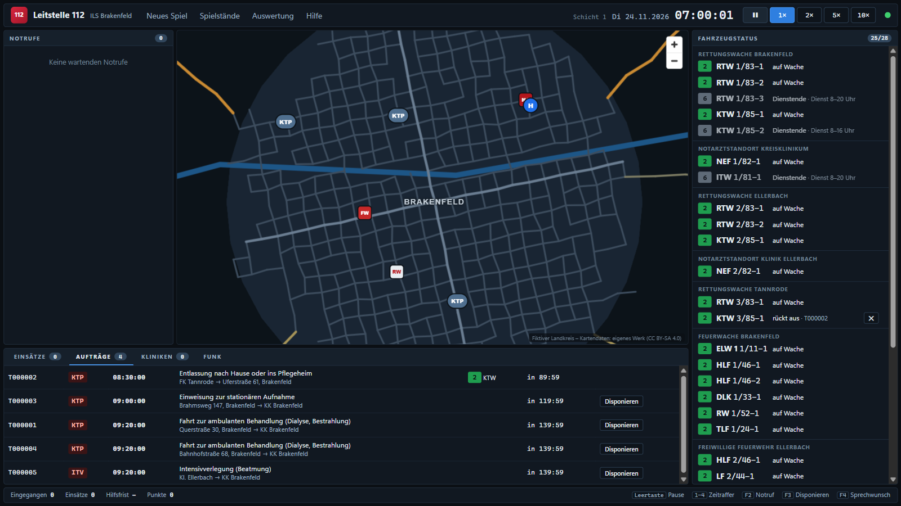
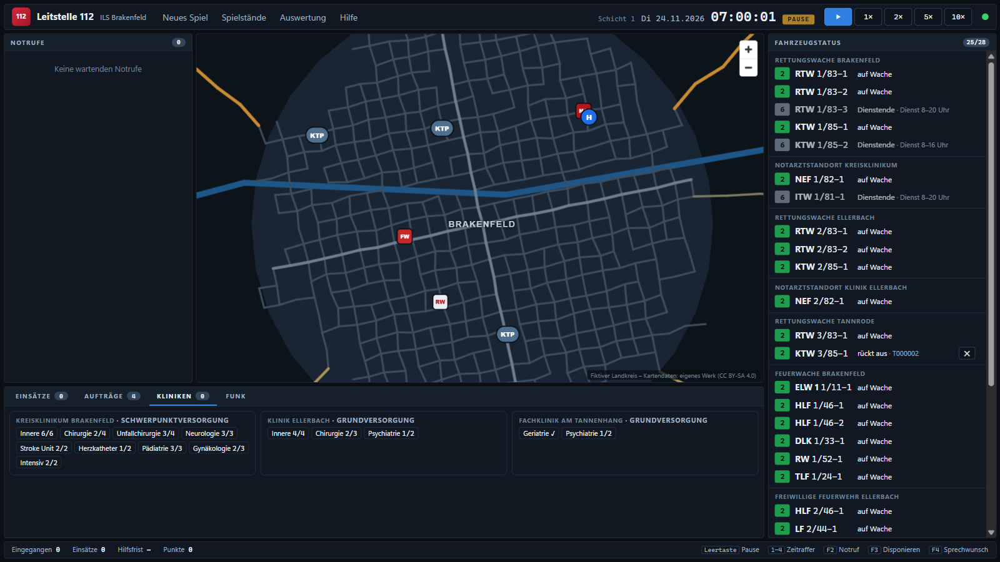

# Rettungsdienst-Logistik (seit 0.4.0)

Daten: [`content/base/krankentransport.yaml`](../../content/base/krankentransport.yaml),
[`content/base/einstellungen.yaml`](../../content/base/einstellungen.yaml) (`transports`,
`logistics`) und [`content/base/fahrzeuge-wachen-kliniken.yaml`](../../content/base/fahrzeuge-wachen-kliniken.yaml).
Entscheidung: [ADR-0015](../adr/0015-rd-logistik.md). Alle Werte sind **Annahmen** für ein
glaubwürdiges Spiel. Sie sind keine Vorgaben eines Rettungsdienstgesetzes oder eines realen
Bedarfsplans.

## Fahrzeuge und Transportklassen

| Typ | Klasse            | Einsatz                                                             |
| --- | ----------------- | ------------------------------------------------------------------- |
| RTW | Notfall           | Notfälle, Verlegungen mit Überwachung; Krankentransport möglich     |
| NAW | Notfall + Notarzt | Wie RTW, bringt den Notarzt mit (im Landkreis nicht stationiert)    |
| KTW | Krankentransport  | Krankentransporte und Verlegungen ohne Überwachung                  |
| ITW | Intensiv          | Intensivverlegungen (Beatmung, Katecholamine) mit Intensivmediziner |

- Nur die Klasse **Notfall** transportiert Notfallpatienten und zählt für die **Hilfsfrist**.
  Ein KTW kann am Notfallort Erste Hilfe leisten und den Erstbefund melden, der Vorschlag verlangt
  aber weiter einen RTW.
- Fährt ein Fahrzeug einer niedrigeren Klasse einen Auftrag (KTW für eine Verlegung mit
  Überwachung), ist das der Fehler „ungeeignetes Fahrzeug“. Eine höhere Klasse ist erlaubt: Ein RTW
  darf einen Krankentransport fahren, fehlt dann aber für Notfälle. Diese Abwägung ist gewollt.

## Transportaufträge

Krankentransporte kommen nicht über die 112, sondern von Praxen, Kliniken und Pflegeheimen. Sie
erscheinen im Reiter **„Aufträge“** mit Abholtermin, Abholort und Ziel.

| Auftrag                          | Stichwort | Von → nach                    | Vorlauf     |
| -------------------------------- | --------- | ----------------------------- | ----------- |
| Einweisung                       | KTP       | Wohnung → Klinik              | 20–150 Min. |
| Entlassung                       | KTP       | Klinik → Wohnung/Pflegeheim   | 30–120 Min. |
| Ambulante Behandlung (Dialyse)   | KTP       | Wohnung → Kreisklinikum       | 60–240 Min. |
| Verlegung in die Geriatrie       | KTP       | Klinik → Fachklinik Tannrode  | 60–180 Min. |
| Dringende Verlegung Herzkatheter | VL        | Kl. Ellerbach → Kreisklinikum | 0–10 Min.   |
| Intensivverlegung                | ITV       | Kl. Ellerbach → Kreisklinikum | 20–60 Min.  |

- **Aufkommen:** 1,6 Aufträge je 100.000 Einwohner und Stunde im Mittel, tagsüber bis zum
  Doppelten, nachts fast keine. Zum Schichtbeginn liegen **fünf am Vortag bestellte** Aufträge mit
  Terminen in den ersten drei Stunden vor.
- **Termine** liegen auf vollen fünf Minuten. Wer zu früh kommt, wartet bis zum Termin; erst dann
  beginnt die Übernahme (z. B. 8–15 Minuten).
- **Pünktlich** ist eine Abholung bis 15 Minuten nach dem Termin. Später gibt es den Fehler
  „Transportauftrag zu spät“ (−10 Punkte). Pünktliche Aufträge bringen +30 Punkte.
- **Storno:** Hat drei Stunden nach dem Termin niemand abgeholt, übernimmt ein anderer Anbieter.
  Der Auftrag zählt als verspätet.
- Aufträge fahren ohne Sonderrechte und brauchen keine Zielklinik-Zuweisung.

## Kliniken: Aufnahmeplätze und Abmeldungen

Jede Fachabteilung hat eine Zahl **freier Aufnahmeplätze für Notfallpatienten** (`beds`), z. B.
Stroke Unit 2, Innere 6. Das ist bewusst keine Bettenzahl, sondern die Kapazität, die die Klinik
gerade für neue Notfälle meldet.

- Jeder Notfalltransport belegt einen Platz. Je Stunde wird etwa die Hälfte der belegten Plätze
  wieder frei (Verlegung auf Station). Andere Patienten – Selbsteinweiser, Nachbarbereiche –
  belegen tagsüber zusätzlich Plätze.
- Sind keine Plätze frei, **meldet sich die Abteilung ab**. Dazu kommen kurzfristige Abmeldungen
  wegen **Geräteausfall** (CT, Herzkatheter) für 1–3 Stunden, im Mittel etwa jeden dritten Tag je
  Klinik.
- Der Zielklinik-Vorschlag umgeht abgemeldete Abteilungen. Wer trotzdem dorthin fährt, obwohl
  eine andere geeignete Klinik aufnahmebereit war, macht den Fehler „abgemeldete Abteilung“
  (−10 Punkte).
- **Ausnahme vitale Bedrohung:** Ab NACA 5 gilt die Aufnahmepflicht der nächsten geeigneten
  Klinik. Dann zählt nur die Fahrzeit (Annahme, angelehnt an verbreitete Regelungen der
  Notfallaufnahme).
- Aufträge belegen keine Notfallplätze: Geplante Aufnahmen sind mit der Klinik abgestimmt.

## Vorhaltung, Besatzungen und Pausen

- **Dienstzeiten:** Einige Fahrzeuge sind nur zu bestimmten Zeiten besetzt, etwa der Tages-RTW
  (8–20 Uhr) oder KTW (werktags). Außerhalb davon stehen sie mit Status 6 „Dienstende“ auf der
  Wache. Endet der Dienst während eines Einsatzes, wird der Einsatz zu Ende gefahren.
- **Besatzungswechsel** der rund um die Uhr besetzten Fahrzeuge um 7 und 19 Uhr. Läuft dann ein
  Einsatz, macht die alte Besatzung **Überstunden**; die Auswertung zählt sie.
- **Pausen:** Nach sechs Stunden Dienst bittet die Besatzung per Funk um ihre Pause (angelehnt an
  § 4 Arbeitszeitgesetz: 30 Minuten bei mehr als sechs Stunden). Der Disponent genehmigt sie mit
  dem Knopf **„Pause“** in der Fahrzeugliste. Das Fahrzeug ist dann 30 Minuten in Status 6 auf der
  Wache. Eine Pause lässt sich vorzeitig beenden; die genommene Zeit zählt. Wer bis zum
  Schichtende keine 30 Minuten Pause bekommen hat, gilt als **Arbeitszeitverstoß** (−10 Punkte).
  Ohne Antwort erinnert die Besatzung alle 90 Minuten.

## Status 6 – nicht einsatzbereit

| Grund        | Auslöser                                  | Dauer            |
| ------------ | ----------------------------------------- | ---------------- |
| Desinfektion | Transport eines infektiösen Patienten     | 30–50 Min.       |
| Defekt       | 0,8 % je Einsatz (Annahme)                | 1–3 Stunden      |
| Tanken       | Tankfüllung unter 25 % nach einem Einsatz | 10–15 Min.       |
| Pause        | Genehmigte Pause                          | 30 Min.          |
| Dienstende   | Ende der Dienstzeit                       | bis Dienstbeginn |

Das Fahrzeug fährt mit Status 6 zur Wache und ist erst danach wieder verfügbar. Eine Tankfüllung
reicht für etwa acht Stunden Fahrt; zum Spielbeginn sind die Tanks unterschiedlich voll.

Infektionen kommen mit einer Wahrscheinlichkeit je Krankheitsbild vor, z. B. 15 % bei Atemnot
(Pneumonie, Influenza) und 6 % beim akuten Abdomen (Gastroenteritis). Bei Aufträgen steht die
Infektion im Transportschein und ist vorher bekannt.
