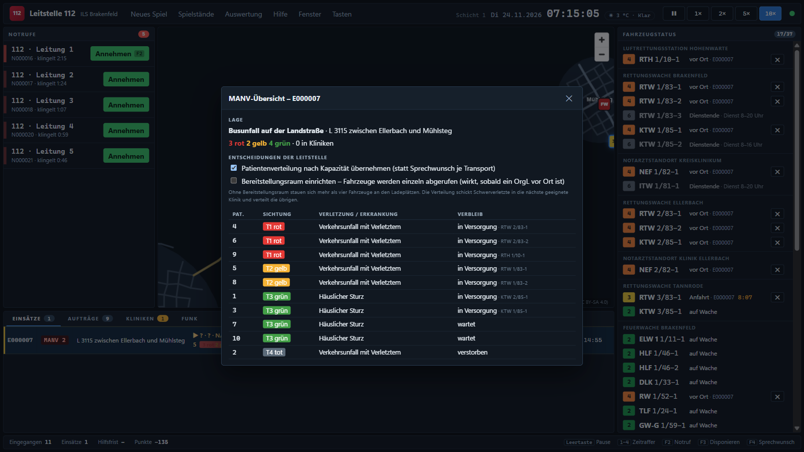

# Massenanfall von Verletzten und Großlagen (seit 0.7.0)

Daten: [`content/base/manv.yaml`](../../content/base/manv.yaml) und `mci` in
[`einstellungen.yaml`](../../content/base/einstellungen.yaml). Entscheidung:
[ADR-0017](../adr/0017-manv-grosslagen.md). Alle Zahlen sind **Annahmen** für ein glaubwürdiges
Spiel. Sie sind kein MANV-Konzept eines realen Landkreises.

## Großlagen

| Großlage                      | Stichwort | Betroffene | Besonderheit                                  |
| ----------------------------- | --------- | ---------- | --------------------------------------------- |
| Busunfall auf der Landstraße  | MANV 2    | 9–18       | technische Rettung (HLF, RW)                  |
| Massenkarambolage, Autobahn   | MANV 1    | 5–11       | bei Nebel und Glätte sechsmal häufiger        |
| Zugunglück am Bahnübergang    | MANV 3    | 20–35      | selten, sehr viele Leichtverletzte            |
| Großbrand Mehrfamilienhaus    | B 4       | 5–12       | Brandbekämpfung mit DLK, Rauchgasvergiftungen |
| Chlorgasaustritt Hallenbad    | ABC 1     | 8–20       | Gerätewagen Gefahrgut, überwiegend leicht     |
| Evakuierung eines Pflegeheims | MANV 2    | 12–25      | bei Hitze und Gewitter häufiger, kaum Schwere |

Im Mittel kommt etwa alle drei Wochen eine Großlage vor (5 % je Tag). Über den Spielbeginn
**MANV-Übung** startet eine Schicht direkt mit einer Großlage.

## Ablauf

1. **Notruf:** Der Anrufer schildert viele Betroffene; zu Bewusstsein und Atmung kann er nichts
   Genaues sagen. Das passende Stichwort (MANV 1–3, B 4, ABC 1) alarmiert Rettungsdienst,
   Leitenden Notarzt (LNA), Organisatorischen Leiter (OrgL) und – ab MANV 2 – die
   Schnelleinsatzgruppe (SEG).
2. **Lagemeldung:** Das erste Fahrzeug meldet die geschätzte Zahl der Betroffenen. Danach richtet
   sich der Vorschlag nach dem tatsächlichen Bedarf.
3. **Sichtung:** Mit LNA oder Notarzt dauert sie 6–10 Minuten, nur durch Besatzungen 15–25 Minuten.
   Danach zeigt die MANV-Übersicht jeden Patienten mit Kategorie:

   | Kategorie | Bedeutung                      | Versorgung bis transportfähig  | Ziel                                     |
   | --------- | ------------------------------ | ------------------------------ | ---------------------------------------- |
   | T1 rot    | akute Lebensgefahr             | 15–25 Min., Arzt vor Ort nötig | Klinik in der ersten Stunde              |
   | T2 gelb   | schwer verletzt                | 10–15 Min.                     | Klinik innerhalb von zwei Stunden        |
   | T3 grün   | leicht verletzt                | 5–10 Min.                      | teils Klinik (KTW genügt), teils vor Ort |
   | T4        | tot bzw. ohne Überlebenschance | –                              | –                                        |

4. **Transport:** Freie Transportmittel an der Einsatzstelle übernehmen den dringendsten
   passenden Patienten. KTW fahren nur Leichtverletzte, der Hubschrauber vor allem
   Schwerverletzte.
5. **Leichtverletzte ohne Transportbedarf** werden 25–40 Minuten nach der Sichtung vor Ort
   versorgt und entlassen – mit Gerätewagen Sanität (GW-San) schneller.
6. Der Einsatz endet, wenn alle Patienten in Kliniken, vor Ort versorgt oder verstorben sind und
   die Feuerwehr fertig ist.

## Entscheidungen der Leitstelle

- **Bereitstellungsraum:** Ohne ihn stauen sich mehr als vier Fahrzeuge an den Ladeplätzen; jedes
  weitere braucht 3 Minuten länger. Mit Bereitstellungsraum und OrgL vor Ort werden Fahrzeuge
  einzeln abgerufen (+2 Minuten, kein Stau).
- **Patientenverteilung:** Entweder fragt jeder Transport per Sprechwunsch nach dem Ziel, oder die
  Verteilung nach Kapazität übernimmt: Schwerverletzte in die nächste geeignete Klinik, die
  übrigen auf aufnahmebereite Kliniken verteilt. Die Kliniken der Nachbarkreise (Halvern,
  Wennbach) fangen Spitzen auf.
- **Reserven:** SEG und Einsatzleitung schlägt der Vorschlag nur bei Großlagen vor. Ehrenamtliche
  SEG-Kräfte brauchen 10–20 Minuten bis zum Ausrücken.

## Bewertung

Jeder Patient zählt einzeln in der Auswertung (gut +40, beeinträchtigt +15):

- **T1:** Überlebenswahrscheinlichkeit 95 %, ab der ersten Stunde je Minute 1 Prozentpunkt
  weniger, mindestens 30 %. Ein vermeidbarer Tod kostet 30 Punkte.
- **T2:** gut bis zwei Stunden nach dem Notruf, danach beeinträchtigt.
- **T3:** gut, wenn versorgt (Klinik oder vor Ort).
- **Fehler:** Großlage mit einfachem Stichwort alarmiert (Untertriagierung), Klinik überlastet,
  obwohl andere aufnahmebereit waren (−15 Punkte).
